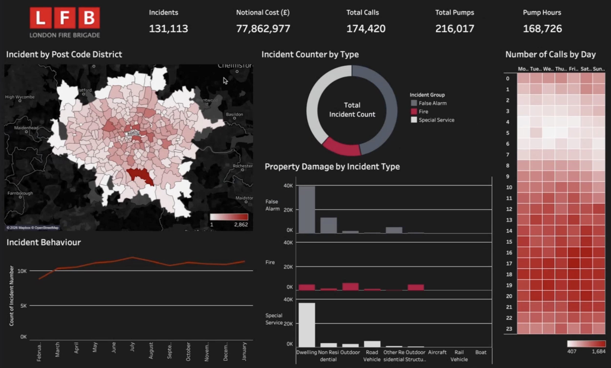
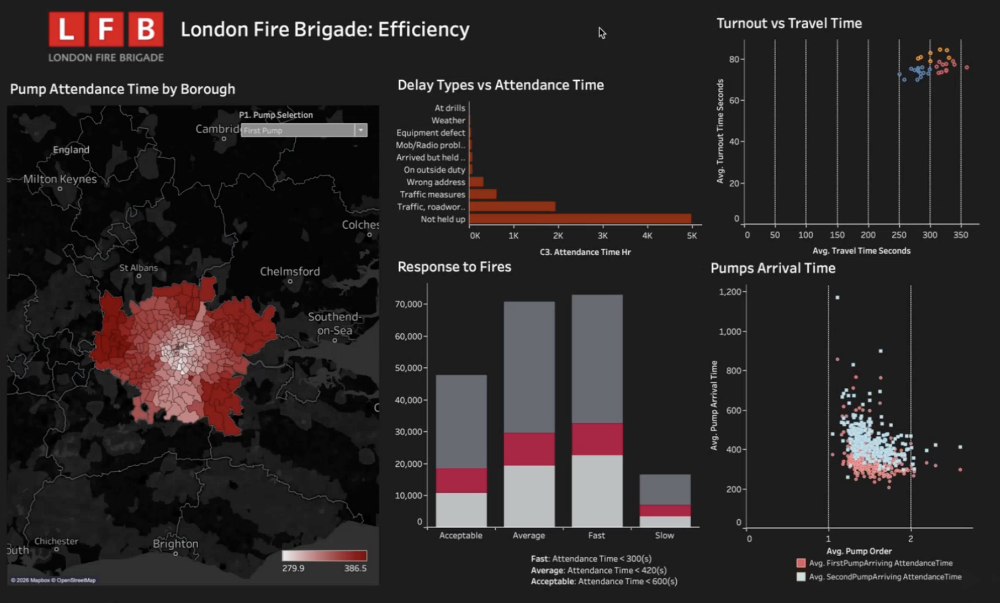
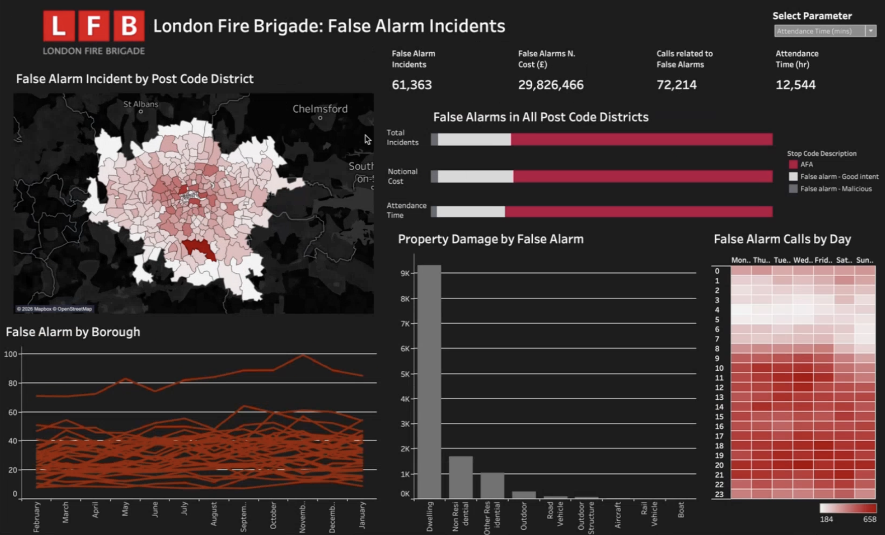
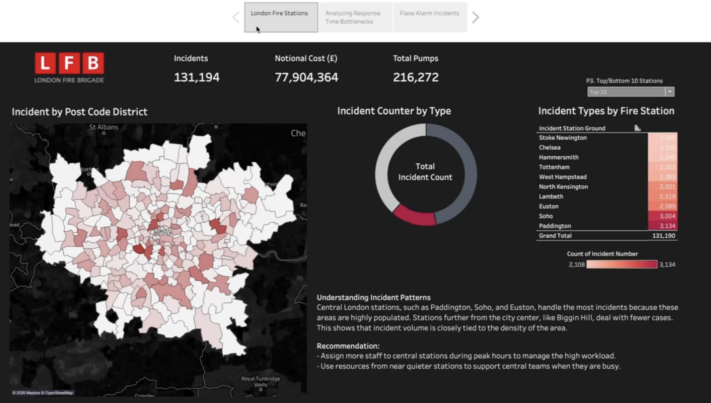
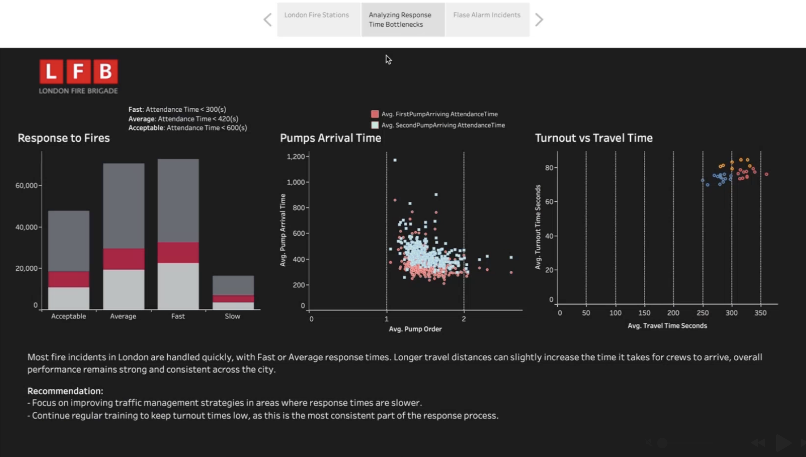
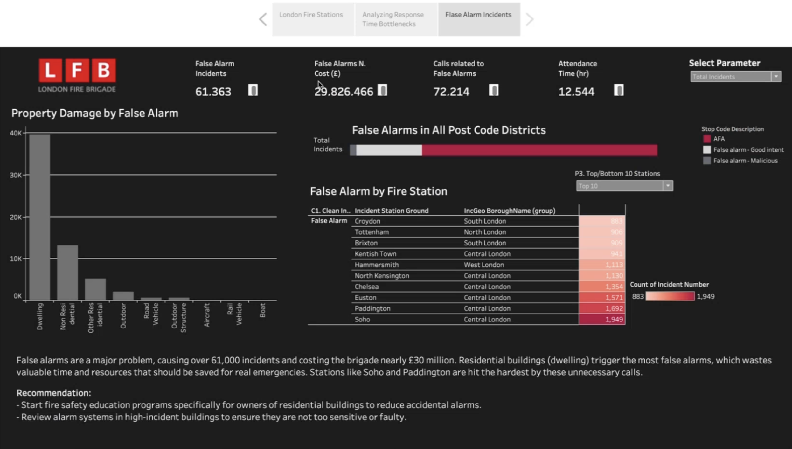

# London Fire Brigade Incident Analysis (Tableau)

A Tableau analysis of London Fire Brigade (LFB) incident and mobilisation data, covering Incident behaviours, Efficiency of the LFB, Impact of false alarms. It includes three dashboards and a three-part data story with recommendations.

## Business Problem
How do emergency incidents behave across London, how efficiently does the LFB respond, and what is the frequency and resource cost of false alarms?

## Scope of the Analysis
The LFB is one of the world's largest firefighting and rescue organisations, protecting nearly 9 million people across Greater London. It keeps detailed incident and mobilisation records for every fire engine deployed, including the appliance mobilised, its station of origin and arrival times at each scene. This case study focuses on three areas:

1. **Incident behaviours:** trends and patterns across incident groups
2. **Efficiency of the LFB:** response performance
3. **Impact of false alarms:** the frequency and resource cost of non-emergency incidents

## Data
- **Source:** London Fire Brigade open data
- **Period:** 1 February 2025 – 31 January 2026
- **Relationship:** one incident can have many mobilisation records, so the two tables are linked on `IncidentNumber`

## Tools Used
- **Tableau:** worksheets, calculated fields, parameters, dashboard actions and story points

## Data Preparation
1. Created a relationship between incident and mobilisation datasets on `IncidentNumber` and filtered both datasets to 1 February 2025 – 31 January 2026.
2. Ran the Data Interpreter on both datasets to clean the data
3. Assigned geographic roles to postcode fields, and some postcode districts were not recognised by Tableau, so added their latitude and longitude values manually.
4. The data had no region field, so created a group of borough names into five regions (North, East, South, West and Central London)
5. Converted attendance time from seconds to hours for cost and workload views
6. Applied filters to exclude invalid or irrelevant property and incident records

## Approach
- The worksheets were grouped into three dashboards:
1. **Incident Dashboard:** postcode district map, incident type split, monthly behaviour, property damage and calls by day and hour
 
2. **Efficiency Dashboard:** pump attendance time by area, delay types, response bands, pump arrival order and turnout vs travel time
     
3. **False Alarm Dashboard:** false alarms by postcode district, stop code, property type, fire station, borough and time of day

- Created a calculated field to group attendance time into response bands:
  - Fast: under 300 seconds
  - Average: under 420 seconds
  - Acceptable: under 600 seconds
  - Slow: 600 seconds or more
- Set the bands using LFB's published response figures as a benchmark: an average of 6 minutes for the first engine and 8 minutes for the second anywhere in London, and an average first engine response of 5 minutes 20 seconds in the [Fire & Rescue Service 2023-2025 inspection report(PDF)](report/Fire-&-Rescue-Service-2023-2025-inspection-report.pdf)
- Added parameters so users can switch between first and second pump, view the top or bottom 10 stations, and change the false alarm measure (total incidents, notional cost or attendance time)
- Added dashboard actions so clicking a postcode district or incident group filters the other charts
- Combined the dashboards into a three-part data story: London fire stations, Response time bottlenecks, False alarm incidents

## Key Findings
**1. Incident behaviour**

<p align="center">
  <br>
  <em>Incident dashboard</em>
</p>

- There were 131,190 incidents over the period, with a notional cost of about £77.9M and 216,000 pumps mobilised
- False alarms were the largest group (61,363, 47%), followed by special services (50,443, 38%) and fires (19,384, 15%)
- South London recorded the most incidents of the five regions (48,712, about 37%)
- Monthly incidents rose from about 9,000 in February to a peak of about 12,000 in July
- Calls are lowest in the early morning and rise through the day into the evening
- Central London stations handled the most incidents, led by Paddington (3,134), Soho (3,004) and Euston (2,589), while stations further out, such as Biggin Hill, handle far fewer. Incident volume is closely tied to the density of the area
- Dwellings account for the largest share of both false alarm and special service incidents

**2. Efficiency of the LFB**

<p align="center">
  <br>
  <em>Efficiency dashboard</em>
</p>

- Most responses fall into the Fast or Average bands, and Slow responses are the smallest group
- Central London has the shortest attendance times for both the first and second pump. Average first-pump attendance ranges from about 280 to 387 seconds across areas, with longer times in outer London
- The first pump typically arrives in about 300 seconds and the second pump within about 450 seconds
- Across London, traffic and roadworks are the largest delay causes, apart from incidents that were not held up
- Travel time (about 250–350 seconds on average) is the largest part of the response, while turnout time is short and consistent (about 60–85 seconds)

**3. Impact of false alarms**

<p align="center">
  <br>
  <em>False alarm dashboard</em>
</p>

- False alarms caused 61,363 incidents, 72,214 calls and about £29.8M in notional cost, about 38% of the total
- About three-quarters of false alarms come from automatic fire alarms (AFAs), with good-intent and malicious calls much smaller. In the SE9 postcode district, AFAs account for more than 67%
- Dwellings produce the most false alarms, followed by non-residential buildings
- Soho (1,949), Paddington (1,692) and Euston (1,571) are the stations hit hardest, and most of the top 10 are in central London
- False alarm calls peak on weekday daytime and evening hours

**Data story**

<p align="center">
  <br>
  <em>Data story: London fire stations</em>
</p>

<p align="center">
  <br>
  <em>Data story: Response time bottlenecks</em>
</p>

<p align="center">
  <br>
  <em>Data story: False alarm incidents</em>
</p>

## Recommendations
1. Add staff to central stations at peak hours and use resources from quieter nearby stations to support them when busy
2. Improve traffic management in slower areas, since travel time is the main driver of longer response times
3. Keep up regular turnout training, as turnout is the most consistent part of the response
4. Run fire safety education for owners of residential buildings to reduce accidental alarms
5. Review alarm systems in high-incident buildings to check they are not too sensitive or faulty

## Limitations
- Notional cost is an estimate of resource use, not actual spending
- Response bands are based on LFB's published average response figures, not official LFB bands
- The analysis covers one year, so it can't show longer-term trends
- The analysis is descriptive, so it shows patterns rather than causes

## Skills Demonstrated
- Data cleaning and preparation (Data Interpreter, filtering, geographic roles, manual data fixes)
- Relating and modelling two datasets
- Calculated fields, parameters and table calculations in Tableau
- Dashboard design with KPIs, filter actions and tooltips
- Data storytelling and turning findings into practical recommendations

## Repository Structure
```
├── README.md
├── data/        incident and mobilisation datasets
├── report/      Fire & Rescue Service 2023 2025 inspection report
└── images/      dashboard and story screenshots
```

## Author
Hashen Rathnayake | [LinkedIn](https://www.linkedin.com/in/hashen-rathnayake-074885207/)
